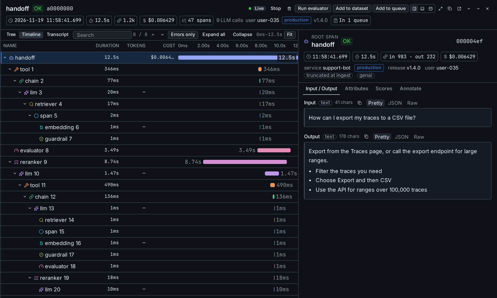
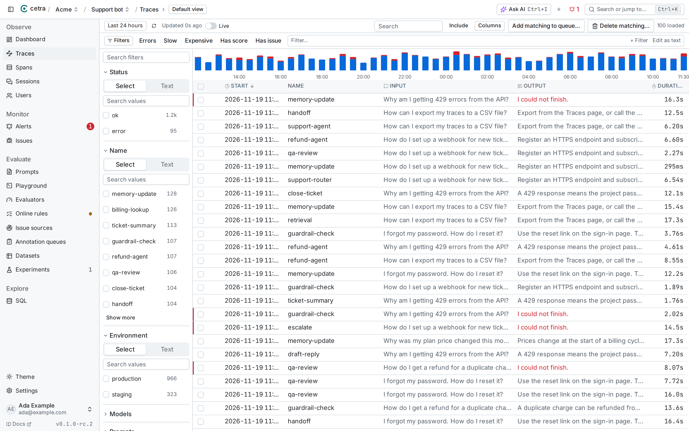
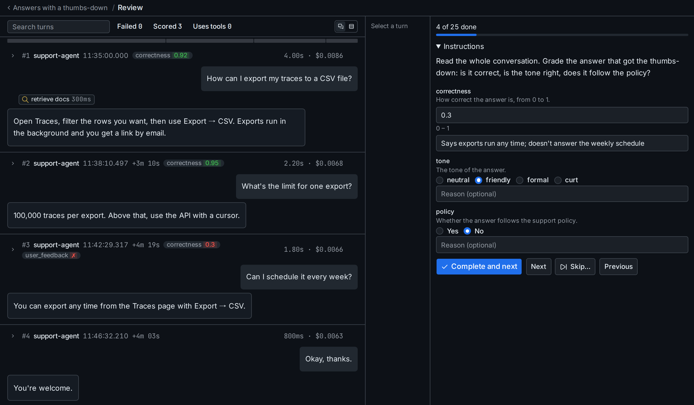
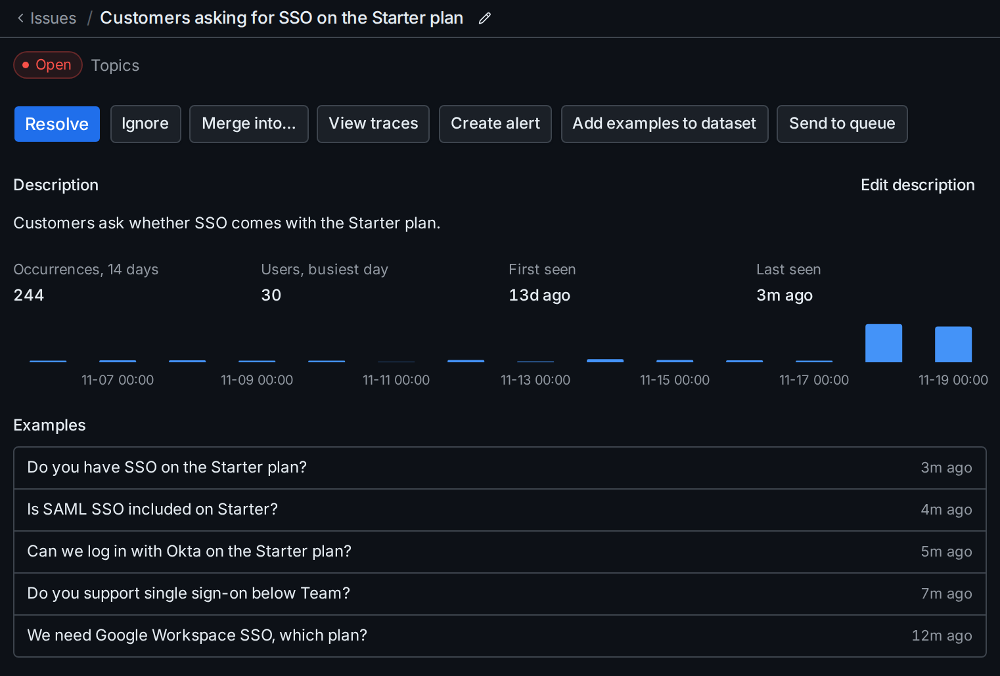
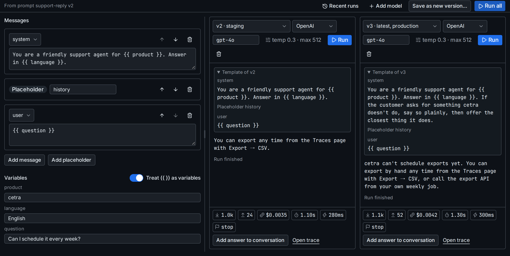
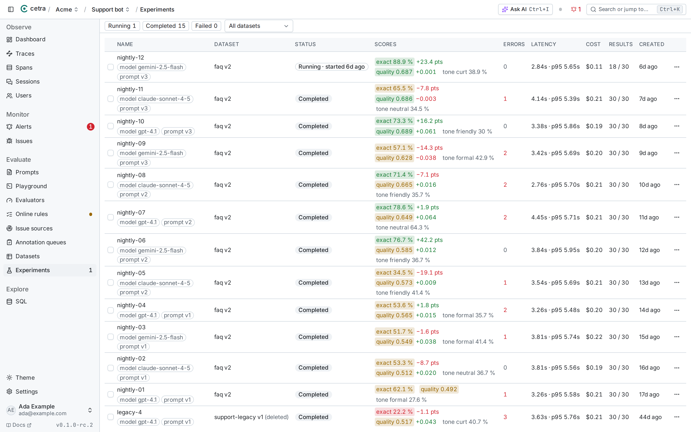
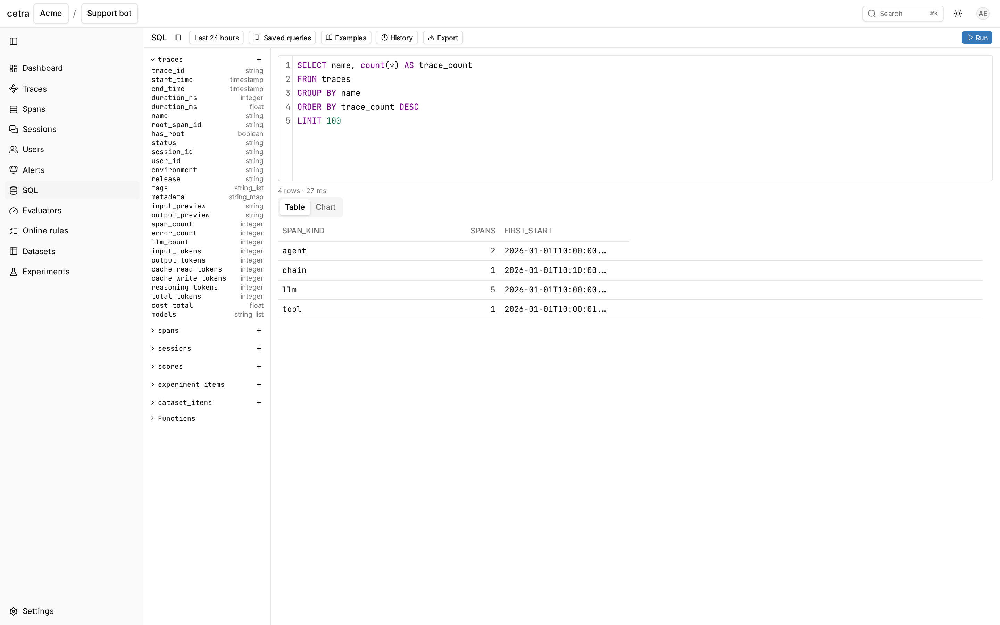
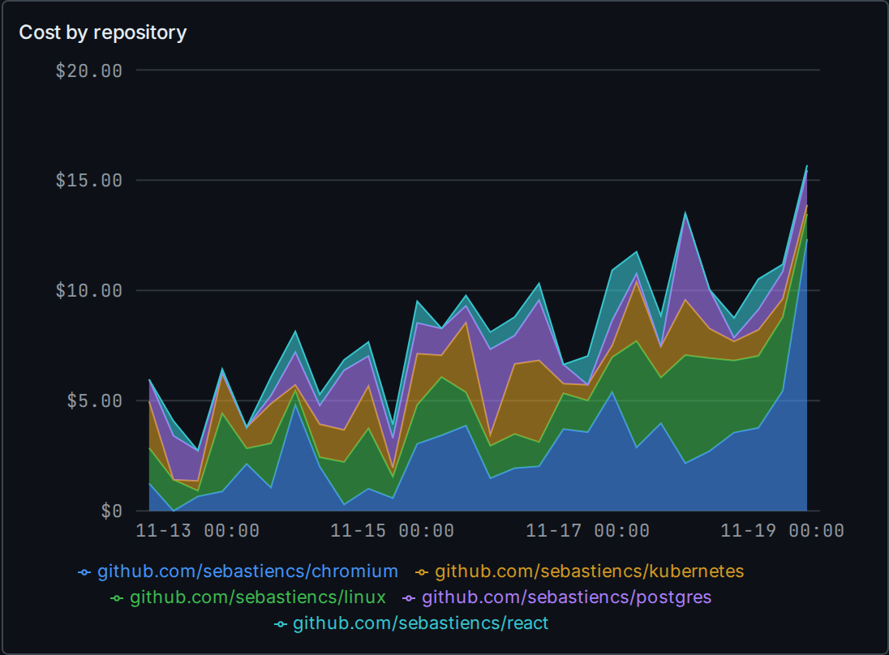
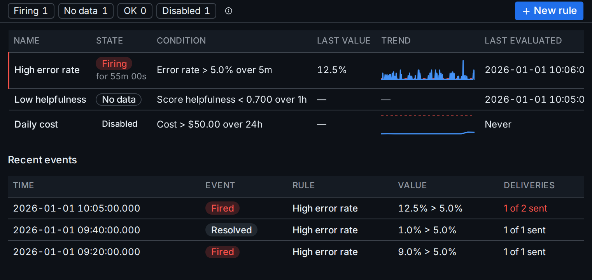

<div align="center">

<picture>
  <source media="(prefers-color-scheme: dark)" srcset="assets/brand/cetra-logo-on-dark.svg">
  
</picture>

### Open-source LLM observability in one binary.<br>Traces, evals, prompts, issues and alerts, in our cloud or on your server.

**[Start free](https://app.cetra.sh/signup)** · [Live demo](https://demo.cetra.sh) · [Self-host](https://cetra.sh/docs/self-hosting/) · [Docs](https://cetra.sh/docs/) · [Compare](https://cetra.sh/compare/)

[](https://github.com/cetra-ai/cetra/releases)
[](https://pypi.org/project/cetra-sdk/)
[](https://www.npmjs.com/package/@cetra-ai/sdk)
[](LICENSE)

<a href="https://demo.cetra.sh"></a>

<sub>Click the screenshot to open the live demo: the real UI on sample data, no sign-up.</sub>

</div>

## Why cetra

- **One binary, nothing to babysit.** `cetra serve` is the whole product: OpenTelemetry ingestion,
  its own storage engine, the API and the web UI. Others ask you to run ClickHouse, Postgres, Redis
  and a queue. cetra keeps its data in one directory, or in any S3-compatible bucket.
- **Fast at volume, on one machine.** A write-ahead log and columnar files queried by cetra's own
  engine, built in Rust. See [Benchmarks](#benchmarks).
- **Find what's broken before your users do.** Online evaluations score live traffic with LLM
  judges and code checks, issues group failures by fingerprint and topic, and alerts reach Slack,
  email or a signed webhook.
- **Ask anything in SQL.** A read-only SQL console, the same SQL over the API, and an MCP server, so
  you and your coding agent can query every span.
- **No lock-in.** Standard OpenTelemetry in (OTLP over HTTP and gRPC), with the GenAI conventions,
  OpenInference, OpenLLMetry and the Vercel AI SDK understood out of the box. An MIT core you can
  host yourself.

## Get started

### cetra Cloud: the fastest way

[Sign up](https://app.cetra.sh/signup) and send your first trace in a minute. The **Free plan**
includes 100k units a month, in the EU or the US region. Paid plans start at
$30 a month ([pricing](https://cetra.sh/pricing/)).

### Let your coding agent do it

```bash
npx @cetra-ai/cli@latest init
```

It signs you in, writes your keys to `.env`, installs the cetra skill for your coding agent, and
prints the prompt that instruments your app.

### Self-host it

```bash
curl -fsSL https://cetra.sh/install.sh | sh
cetra serve
```

Open the setup link it logs, and create the first admin, organization and project. cetra listens
on port 8080 for the UI, the API and OTLP/HTTP, and on 4317 for OTLP/gRPC. Docker, Kubernetes,
S3 and backups: see the [self-hosting guide](https://cetra.sh/docs/self-hosting/).

### Send a trace

```bash
pip install cetra-sdk
```

```python
import cetra

cetra.init()  # reads CETRA_API_KEY and CETRA_BASE_URL


@cetra.observe()
def answer(question: str) -> str:
    return llm(question)
```

Using TypeScript, LangChain, the OpenAI Agents SDK, LiteLLM or plain OpenTelemetry? See the
[quick start](https://cetra.sh/docs/get-started/quickstart/) and the
[integrations](https://cetra.sh/integrations/).

## What you get

<table>
  <tr>
    <td width="50%"><b>Traces, sessions and users</b><br>Every span with its cost, tokens and latency, full-text search, and a filter language.<br></td>
    <td width="50%"><b>Evaluations on live traffic</b><br>LLM judges and code checks score new traces as they arrive, with a spend cap.<br></td>
  </tr>
  <tr>
    <td><b>Issues that find you</b><br>Failures grouped by fingerprint and topic, with their trend and the users they hit.<br></td>
    <td><b>Prompts and a playground</b><br>Versioned prompts, side-by-side comparison and a playground on your own LLM connections.<br></td>
  </tr>
  <tr>
    <td><b>Datasets and experiments</b><br>Versioned datasets, CSV and JSONL import, and runs you compare side by side.<br></td>
    <td><b>SQL over every trace</b><br>A read-only SQL console, the same queries over the API and the MCP server.<br></td>
  </tr>
  <tr>
    <td><b>Your coding agents, traced</b><br>Claude Code, Codex, Cursor and seven more: what each session cost, and what it did.<br></td>
    <td><b>Alerts and dashboards</b><br>Alerts on errors, latency, cost and scores, sent to Slack, email or a signed webhook.<br></td>
  </tr>
</table>

Also: annotation queues for reviewers, an in-app assistant on your own LLM connection, per-trace
deletion that erases the data, retention limits, and SSO, SCIM and audit logs for teams that need
them.

## Benchmarks

> [!NOTE]
> **TODO:** benchmark results land here: ingest throughput, disk per million spans and query
> latency, against Langfuse, Phoenix and a plain Parquet setup, with the commands to rerun them.

| | cetra | Langfuse | Phoenix |
|---|---|---|---|
| Ingest, spans per second | TODO | TODO | TODO |
| Disk per million spans | TODO | TODO | TODO |
| Trace list query, p50 / p99 | TODO | TODO | TODO |
| Machine | TODO | TODO | TODO |

## How cetra compares

| | **cetra** | Langfuse | Phoenix | LangSmith | Opik |
|---|---|---|---|---|---|
| What you run to self-host | **One binary** | 6 services incl. ClickHouse | One container | Enterprise add-on | 8 services incl. ClickHouse |
| Self-hosted licence | **MIT core** | MIT, `ee/` commercial | Elastic 2.0 | Proprietary | Apache-2.0 |
| OpenTelemetry | **HTTP and gRPC** | HTTP only | HTTP and gRPC | HTTP only | HTTP only |
| SQL over your data | **Yes** | No | No | No | No |
| Automatic issue detection | **Yes** | Not documented | Not documented | Plus and up | Not documented |
| Alerts | **Slack, email, webhook** | Slack, PagerDuty, webhook | Arize AX only | Slack, PagerDuty | Slack, PagerDuty, webhook |
| Free cloud tier | **100k units/month** | 50k units/month | Free account | 5k traces/month | 25k spans/month |

<sub>From each product's public docs and pricing, checked on 2026-11-20. Sources and the full
tables: [cetra.sh/compare](https://cetra.sh/compare/).</sub>

## Open source and paid

The core, everything above except the enterprise features, is under the [MIT licence](LICENSE).
You can run it yourself for free.

A few directories (`crates/server/src/ee/`, `crates/token/`, `crates/saml/`, `web/src/ee/` and
`tools/license/`) are under the Elastic License 2.0: single sign-on, SCIM, audit logs and the
other enterprise features need a licence key. [cetra Cloud](https://cetra.sh/pricing/) is how we
fund the project: we run it, upgrade it and back it up, so you don't have to.

## Community and support

- [GitHub issues](https://github.com/cetra-ai/cetra/issues) for bugs and feature requests.
- [Documentation](https://cetra.sh/docs/), including the [API reference](https://cetra.sh/docs/reference/api/overview/).
- [Status](https://status.cetra.sh) of cetra Cloud.
- Email: [hello@cetra.sh](mailto:hello@cetra.sh).

## Contributing

Read [AGENTS.md](AGENTS.md) for the layout, the rules and the `just` commands, the
[technical specification](docs/spec/README.md), and the [roadmap](docs/roadmap.md).
