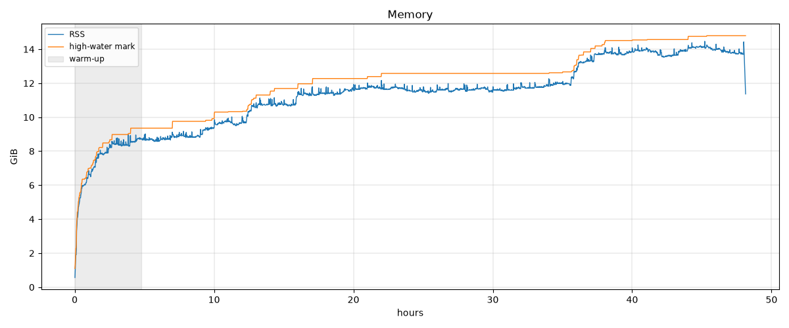
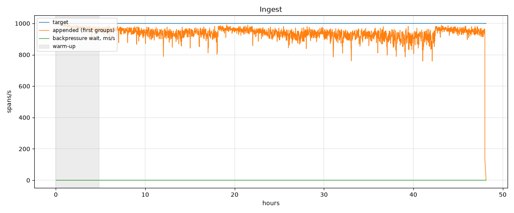
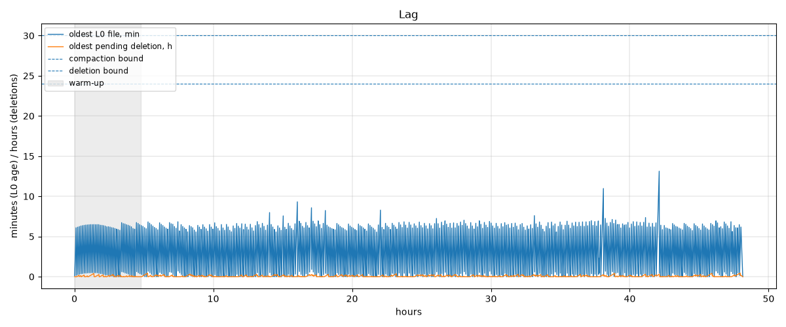
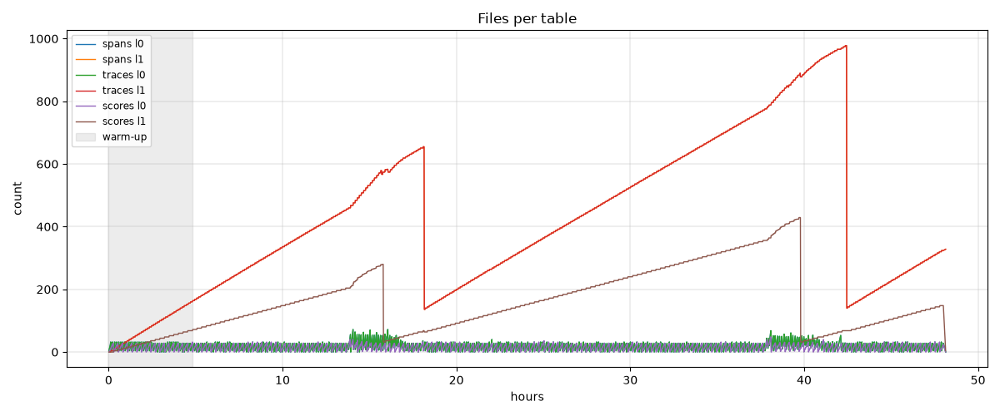
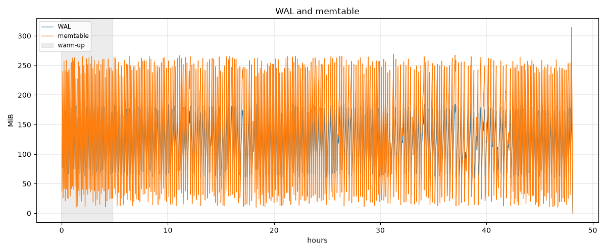
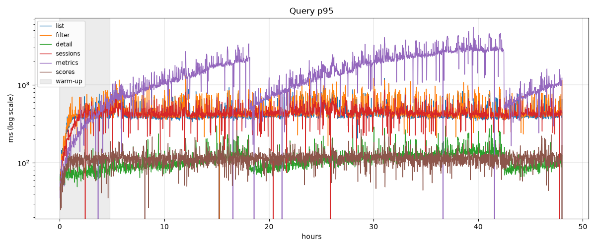
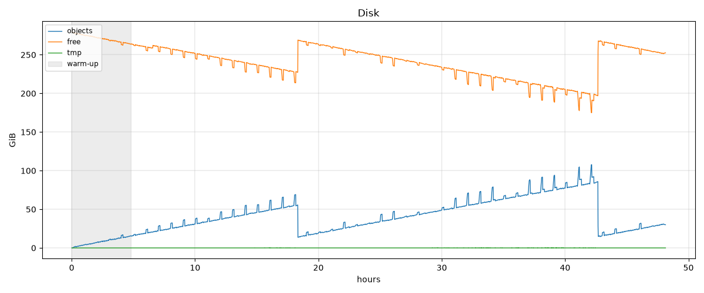
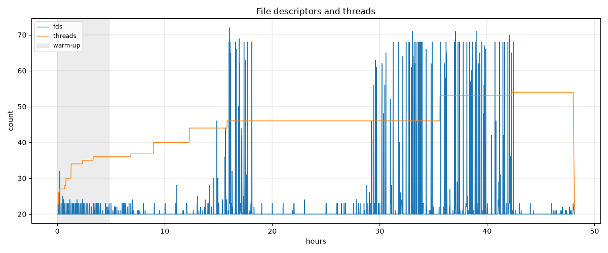
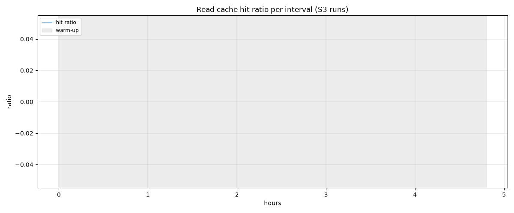

# Storage soak

The soak drives `Storage` at a steady rate for hours. Ingest, score writes, deletions, retention and queries run at the same time, and background compaction stays on. Every minute it records one JSON line of resource and lag samples. At the end it applies pass/fail rules and checks a seeded sample of traces against a registry of what storage must show. The decision is D-R-11 and the plan is `docs/plans/r-hardening/07-m7-scale-soak.md`. Runs are made by hand. The dry run was a 48 h run on a VM (§ Runs); the 72 h run on a dedicated Hetzner AX52 is not made yet.

## Method

- **Workload.** A rate of 2,000 spans/s by default (`CETRA_SOAK_RATE`) across 4 projects with shares 8:4:2:1. Traces are chat, RAG or agent shapes, from 16 apps. LLM spans carry 10–50 KiB of text, other spans under 1 KiB (spec 03's capacity check). The text is oasst2 (Apache-2.0, `just fetch-corpus`, SHA-256 `a9f240c4c77aa1378364f70d37e753c07ba284e247b019d700e1947a0e5da751`). Judge scores are written for 20% of completed traces, with new versions and tombstones of recent scores. Deletions register `Traces` every 10 minutes and `User` every hour. Retention runs hourly for every project, with the boundary `keep_from = (now − 4 h).date − retention_days` in UTC (default `retention_days` 0, so only today is kept, and yesterday until 04:00 UTC). The 4 h lag lets a day close (spec 03 §5) before retention drops it. Queries run at 1 per second (`CETRA_SOAK_QPS`) in the mix list 30, filter 15, detail 25, sessions 10, metrics 10, scores 10.
- **Storage config.** The production defaults of spec 03, plus the data directory, the S3 target (when set), WAL sync `always`, `min_free_bytes` 2 GiB, compaction every 30 s and a read cache of 10% of the filesystem. `GcConfig` has no interval, so GC keeps its default cadence.
- **Samples.** One line per `CETRA_SOAK_SAMPLE_SECS` (default 60 s) in `samples.jsonl`; the fields are the `Sample` struct in `crates/storage/tests/it/soak/sample.rs`. Process values come from `/proc/self`. Ingest values are cumulative counters. Storage values come from `health()`, `read_cache_stats()` and a read-only catalog transaction. Orphans are confirmed only when a path is a suspect in two samples and is older than 10 minutes. Query latencies cover the interval since the last sample. No field holds a path, a host or a bucket. A sample that cannot be read is retried once; a second failure is a `Sample` failure and the run goes on.
- **Machine.** The machine line in `run.json` describes the disk under the data directory. In S3 runs the objects are in the bucket, so that disk is the local one, not the storage's object store.
- **End of run.** Stop the drivers (pending late groups are appended). Take a sample. Shut down, drop and reopen the storage, timing both. Run the oracle at full size. Settle for at most three rounds: wait for the timed flush, then compact and apply deletions at now + 3 days, then GC. Take a settled sample, run the oracle again, then shut down. The S3 prefix of a passing run is deleted unless `CETRA_SOAK_KEEP=1`.
- **Redaction.** `run.json` and `summary.json` are redacted before they are written. The bucket, the S3 endpoint host, `$HOME` and the hostname become placeholders. `events.jsonl` is scrubbed into `events.scrubbed.jsonl`, and only the scrubbed file is committed.

## Rules

Growth rules are enforced only when `hours ≥ max(warmup_hours, (retention_days + 1) × 24) + 24`. Enforced growth reads from `max(warmup_hours, (retention_days + 1) × 24 h)`; shorter runs read from `warmup_hours` and report `Info`. Samples after the run's end (`hours` plus one sample interval, the stop and the settle) are not growth, `compaction_lag` or `rss_max` evidence. `compaction_lag` always reads from `warmup_hours`. `query_growth_<kind>` skips samples with no queries of that kind. Harness rules are always enforced. `Skipped` and `Info` rules never count as a pass.

| Rule | Check | Bound | Kind |
|---|---|---|---|
| `rss_growth` | `grows(rss_bytes)` | rel 0.10, abs 256 MiB | growth |
| `fd_growth` | `grows(fds)` | rel 0.10, abs 64 | growth |
| `thread_growth` | `grows(threads)` | rel 0.10, abs 8 | growth |
| `wal_growth` | `grows(wal_bytes)` | rel 0.5, abs 2 × `wal.segment_bytes` | growth |
| `memtable_growth` | `grows(memtable_bytes)` | rel 0.5, abs `flush.max_bytes` | growth |
| `l0_growth` | `grows(files.spans.l0)` | rel 0.5, abs `compaction.l0_files` | growth |
| `query_growth_<kind>` | `grows(p95_ms)` per kind | rel 0.5, abs 50 ms | growth |
| `rss_max` | max `rss_bytes` | ≤ `max_rss_gib` (8) | harness |
| `ingest_rate` | Δappended / Δtarget of first-group spans, 1 h windows from 15 min (10 min windows for runs under 2 h) | ≥ 0.99 | harness |
| `compaction_lag` | max `l0_oldest_age_s` after warm-up | ≤ `max_l0_age_min` (30) | harness |
| `day_close` | `overdue_partitions` | 0 at every sample | harness |
| `retention` | `retention_violations` | 0 at every sample | harness |
| `deletion_lag` | max `oldest_pending_deletion_s`; every deletion applied by the end | ≤ 24 h | harness |
| `orphans` | confirmed `orphans` | 0 at every sample | harness |
| `wal_failed` | any sample | never | harness |
| `sampling` | samples that could not be taken (after a retry) | 0 | harness |
| `appends`, `queries`, `deletions`, `retention_calls` | failure counts | 0 | harness |
| `log_errors` | ERROR lines in `events.jsonl` | 0 | harness |
| `oracle` | oracle mismatches | 0 | harness |
| `settled` | the settled-state conditions | all hold | harness |

## Runs

| id | date | commit | machine | store | hours | rate | result | data |
|---|---|---|---|---|---|---|---|---|
| `20261122-vm-48h` | 2026-11-22 | 041b2b1 + #214 | VM, 12 vCPUs, virtual disk | local | 48 | 1,000 | fail: `rss_growth`, `rss_max`, `ingest_rate` | [`soak/20261122-vm-48h/`](soak/20261122-vm-48h/) |

The VM run is a dry run on a virtual disk, on a shared VM: its numbers are not publishable bare-metal numbers and back no claim.

### The VM dry run: rate and calibration

The dry run runs on ubuntu-vm: a VM with 12 vCPUs, 94 GB of RAM and a 500 GB virtual disk whose file lives on another server's NVMe. It is a dry run on a virtual disk, on a VM other work shares, not publishable bare-metal numbers. It runs 48 h, so that the growth rules are enforced with `retention_days` 0 (§ Rules), in local mode.

The disk budget for the run was about 150 GB at peak. With `retention_days` 0, a run keeps up to 28 h of data (yesterday until 04:00 UTC, then today), so the default 2,000 spans/s did not fit:
- **Calibration.** One hour at 2,000 spans/s (`CETRA_SOAK_HOURS=1`, label `cal`), and the first 9 h of an earlier run at 400 spans/s that was stopped when the plan changed. Both stored about 1.15 KB per span on disk (14.6 GB of objects for 12.9 M spans after 9 h; 8.7 GB for 7.2 M spans after 1 h, counting files GC had not collected yet). The generator's payload averages 4.6 KB per span, so the stored data is about 4× smaller.
- **Rate.** 28 h at R spans/s takes about R × 116 MB, plus 15% for compaction outputs and files waiting for GC. The WAL stays under 0.1 GB, and local mode has no read cache. `CETRA_SOAK_RATE=1000` gives about 116 GB of data and 135 GB at peak, under the budget, and leaves room under 2,000.
- **What the calibration found.** `settled` failed on a day close that could never fit the compaction pool (M7-1 in `hardening.md`, fixed before the 48 h run). `rss_max` failed (8.49 GiB, M7-2) and `ingest_rate` failed (0.973 of 2,000 spans/s in the last window, M7-3). The oracle, orphans, retention, deletions and `log_errors` passed. **RSS grows; the 48 h run confirmed it (`rss_growth` fails, § `20261122-vm-48h`).** In the stopped 400 spans/s run, RSS went from 6.4 GB at 1 h to 9.8 GB at 3 h and 10.9 GB at 6 h, then held at 10.9 to 11.0 GB until 9 h, with the memtable at 0.25 GB and no read cache (M7-2, M5-7). The stopped 400 spans/s run crossed 04:00 UTC and dropped the previous day on time (24 → 12 partitions), with no failure, orphan or retention violation in 9 h.

## 20261122-vm-48h: 48 h dry run at 1,000 spans/s on a VM

- **Machine.** `Intel(R) Core(TM) i7-8700 CPU @ 3.20GHz`, 12 threads, 94 GiB RAM, kernel 7.0.0-43-generic, disk `vda rota=1` (a virtio disk whose image file is on another server's NVMe), ext4 `rw,relatime,discard,errors=remount-ro,commit=30`, no container. Other work shared the VM's host during the run.
- **Code.** A `git archive` of 041b2b1 with the M7-1 fix and its log field applied (the two commits of #214) and the D3 test fix (M5-9). `run.json` has an empty `commit` because the copy is not a git checkout.
- **Command.** In a `systemd-run --user` unit with `MemoryMax=16G` and `LimitNOFILE=65536`: `CETRA_SOAK_HOURS=48 CETRA_SOAK_RATE=1000 CETRA_SOAK_RETENTION_DAYS=0 CETRA_SOAK_LABEL=vm CETRA_SOAK_DIR=… CETRA_SOAK_OUT=… just soak`. Started 2026-11-22 10:12:53 UTC, ended 2026-11-24 10:23:34 UTC (173,441 s, settle included).
- **Result.** 28 rules, 25 pass, 3 fail. The growth rules are enforced: the run is 48 h, `max(warmup_hours, (retention_days + 1) × 24) + 24` with `warmup_hours` 4.8.

| rule | verdict | detail |
|---|---|---|
| `rss_growth` | **fail** | p95 per quarter 12.61, 13.22, 15.02, 15.21 GB |
| `rss_max` | **fail** | peak RSS 14.47 GiB above 8 GiB |
| `ingest_rate` | **fail** | every 1 h window below 0.99: 0.980 in the first, falling to 0.926 at 18 h, 0.965 after the first retention drop, 0.904 at 41 h, 0.955 after the second drop, 0.945 in the last |
| `fd_growth`, `thread_growth`, `wal_growth`, `memtable_growth`, `l0_growth` | pass | |
| `query_growth_list`, `_filter`, `_detail`, `_sessions`, `_metrics`, `_scores` | pass | |
| `compaction_lag`, `day_close`, `retention`, `deletion_lag`, `orphans`, `wal_failed`, `sampling` | pass | |
| `appends`, `queries`, `deletions`, `retention_calls`, `log_errors`, `oracle`, `settled` | pass | |

- **Key numbers.** From `just soak-plot` and `summary.json`:

| series | min | median | p95 | max |
|---|---:|---:|---:|---:|
| RSS, GiB | 8.576 | 11.65 | 14.01 | 14.47 |
| fds | 20 | 20 | 24 | 72 |
| threads | 21 | 46 | 54 | 54 |
| WAL, MiB | 1.368 | 121.5 | 176.5 | 200.1 |
| memtable, MiB | 0 | 137.5 | 251.1 | 314 |
| spans L0 files | 0 | 16 | 37 | 72 |
| oldest L0 file, s | 0 | 193.1 | 391.6 | 787.7 |
| objects, GiB | 13.74 | 39.57 | 80.67 | 107.8 |

  - Ingest: 936 spans/s on average over the run against 1,000, at 4.6 KB of payload per span (764 GB generated). No backpressure: the wait counter stayed at 0.
  - Process CPU: 1.85 cores on average. Per hour it grew with the retained data, from 1.1 cores at 2 h to 2.2 at 17 h and 2.3 at 41 h, and fell back after each drop.
  - Queries, p95 of the per-minute p95s: list 720 ms, filter 786 ms, detail 173 ms, sessions 615 ms, metrics 3,001 ms (max 5,522 ms), scores 148 ms. 150 k queries, no error.
  - Deletions: 336 registered and applied, none pending at the end. Lag p50 420 s, p95 1,080 s, max 1,681 s.
  - Retention: both daily drops ran (24 → 12 partitions each time). Objects peaked at 107.8 GiB before the second drop; free disk never fell below 188 GB.
  - End of run: shutdown 2.8 s, reopen 0.29 s, settled in 3 compaction passes. The oracle passed at full size and after the settle.
- **Plots.**

- **What it shows.**
  - **RSS grows over two days (M7-2).** It goes up in steps, at about 10 h, 12.5 h, 16 h and 36 h, and does not come back down when retention halves the data. The steps at 12.5 h and 36 h both fall around 22:30 UTC, when the day's partitions are near their largest. The memtable stays under 314 MiB, the WAL under 200 MiB, and local mode has no read cache, so the growth is outside the storage's own budgets. Not located yet.
  - **Ingest falls behind as the retained data grows (M7-4).** The hourly ratio follows the objects on disk: it falls through each day, jumps back after each retention drop, and falls again. CPU and the metrics query's p95 follow the same saw-tooth. There is no backpressure and fsync is not slow, so the driver itself does not get enough time. Queries run on the same 8-worker runtime as ingest, which suggests query load (scans grow with the retained data) takes time from ingest; a run with `CETRA_SOAK_QPS=0` would confirm it.
  - Compaction, day closes, retention, deletions, orphans, the oracle and the settle all held for 48 h with realistic payloads, after the M7-1 fix.
- **Caveats.** A shared VM on a virtual disk, so latencies and the ingest ratio are lower bounds for bare metal. The rate is 1,000 spans/s, half the default, for the disk budget (§ The VM dry run). Local store only.
- **Deviations from the plan.** The rate (1,000 instead of 2,000 spans/s) and the duration (48 h instead of 24 h), set by the coordinating session for the disk budget and the growth rules. `events.jsonl.gz` is the scrubbed log, gzipped (246 KiB). The 53 `compaction job failed` warnings in `summary.json` are all `error = "stopped"`, logged within one second at 10:13:19 when the end of the run stopped compaction mid-rewrite; none happened during the run.

## Claims

| claim | evidence (run id, metric, value) | caveats |
|---|---|---|

No claim is made yet. A claim names the run's rate, machine and duration, and rests only on rules that read `Pass`.
